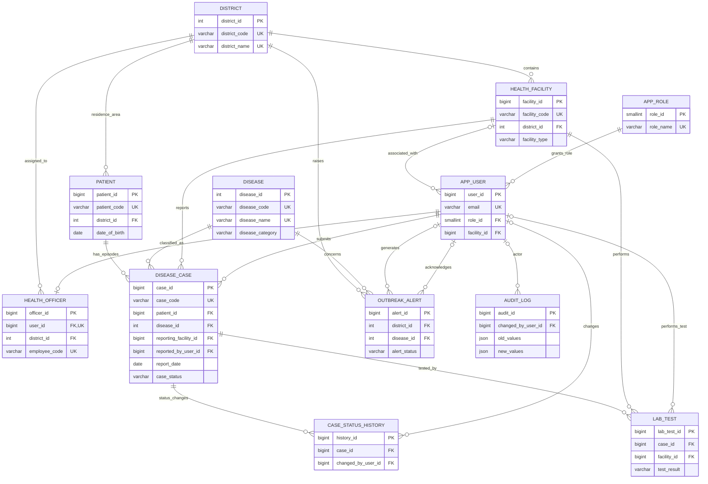

# ER model — Disease Surveillance and Epidemiology Database

## Normalization notes

- Master data is separated into `district`, `health_facility`, `disease`, and `app_role`.
- User credentials/identity live in `app_user`; the district-specific officer attributes live in `health_officer`.
- `disease_case` represents one reported disease episode and references patient, disease, facility and reporting user.
- Laboratory tests and status transitions are separate child relations because each case can have many tests and many status changes.
- `outbreak_alert` stores the alert snapshot and counts used when the alert was generated.
- The schema is designed toward 3NF/BCNF under the stated key assumptions. In your report, explicitly list functional dependencies and verify BCNF for each relation; a diagram alone does not prove BCNF.
