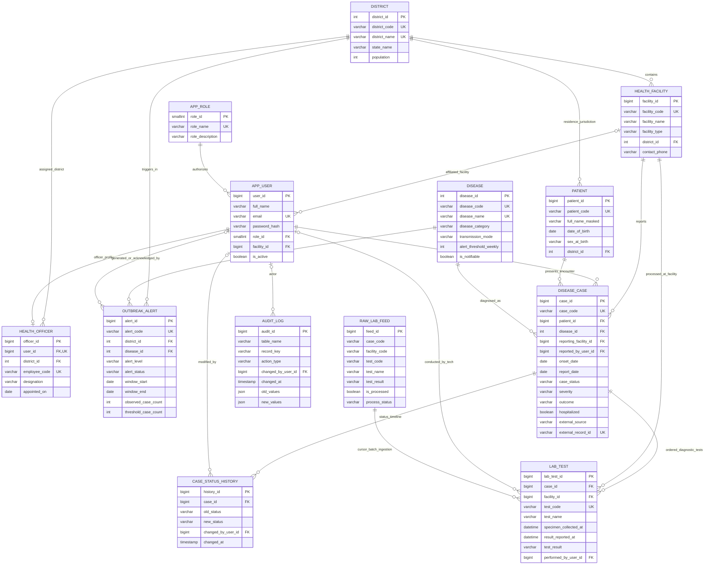

# ER / EER Model & Relational Database Design
## Disease Surveillance & Epidemiology Database (DSED)

---

## 1. Entity-Relationship (ER) Diagram (Mermaid)

---

## 2. Relational Database Design & Normalization (Up to BCNF)

### Functional Dependencies (FD Analysis)

1. **`DISTRICT`**:
   - Candidate Keys: `district_id`, `district_code`, `district_name`
   - $FD_1$: `district_id` $\to$ `district_code`, `district_name`, `state_name`, `population`
   - $FD_2$: `district_code` $\to$ `district_id`, `district_name`, `state_name`, `population`
   - *BCNF Check*: In every non-trivial FD $X \to Y$, determinant $X$ is a superkey. **Holds in BCNF.**

2. **`HEALTH_FACILITY`**:
   - Candidate Keys: `facility_id`, `facility_code`
   - $FD_1$: `facility_id` $\to$ `facility_code`, `facility_name`, `facility_type`, `district_id`, `contact_phone`, `address_line`, `is_active`
   - $FD_2$: `facility_code` $\to$ `facility_id`, `facility_name`, `facility_type`, `district_id`, `contact_phone`, `address_line`, `is_active`
   - *BCNF Check*: Every determinant is a candidate key. **Holds in BCNF.**

3. **`DISEASE`**:
   - Candidate Keys: `disease_id`, `disease_code`, `disease_name`
   - $FD_1$: `disease_id` $\to$ `disease_code`, `disease_name`, `disease_category`, `transmission_mode`, `alert_threshold_weekly`, `is_notifiable`, `description`
   - *BCNF Check*: Determinant is a candidate key. **Holds in BCNF.**

4. **`PATIENT`**:
   - Candidate Keys: `patient_id`, `patient_code`
   - $FD_1$: `patient_id` $\to$ `patient_code`, `full_name_masked`, `date_of_birth`, `sex_at_birth`, `district_id`
   - *BCNF Check*: Determinant is a candidate key. **Holds in BCNF.**

5. **`DISEASE_CASE`**:
   - Candidate Keys: `case_id`, `case_code`, `(external_source, external_record_id)`
   - $FD_1$: `case_id` $\to$ `case_code`, `patient_id`, `disease_id`, `reporting_facility_id`, `reported_by_user_id`, `onset_date`, `report_date`, `case_status`, `severity`, `outcome`, `hospitalized`
   - Notice: Patient details (`date_of_birth`, `district_id`) are not stored here (preventing 2NF partial dependencies and 3NF transitive dependencies). They are referenced purely by FK `patient_id`.
   - *BCNF Check*: Every determinant is a candidate key. **Holds in BCNF.**

6. **`LAB_TEST`**:
   - Candidate Keys: `lab_test_id`, `test_code`
   - $FD_1$: `lab_test_id` $\to$ `case_id`, `facility_id`, `test_code`, `test_name`, `specimen_collected_at`, `result_reported_at`, `test_result`, `performed_by_user_id`
   - *BCNF Check*: Every determinant is a superkey. **Holds in BCNF.**

---

## 3. Lossless Decomposition & Dependency Preservation

All tables are obtained through lossless join decomposition of an unnormalized universal medical encounter relation:
$$U = \{ \text{patient\_id}, \text{dob}, \text{sex}, \text{district}, \text{facility}, \text{disease}, \text{case\_date}, \text{test\_name}, \text{test\_result}, \dots \}$$

By decomposing $U$ into independent normalized schemas:
1. $R_1 \cap R_2 \to R_1$ or $R_1 \cap R_2 \to R_2$ (Lossless Join Property holds via Primary Key - Foreign Key references).
2. All original functional dependencies $F$ can be enforced by constraints on individual relations without requiring joins (Dependency Preservation holds).

---

## 4. Relational Algebra Equivalents for Core Operations

1. **Selection ($\sigma$)**:
   $$\sigma_{\text{case\_status} = '\text{CONFIRMED}' \land \text{severity} = '\text{SEVERE}'}(\text{DISEASE\_CASE})$$
   *SQL:* `SELECT * FROM disease_case WHERE case_status = 'CONFIRMED' AND severity = 'SEVERE';`

2. **Projection ($\pi$)**:
   $$\pi_{\text{patient\_code}, \text{sex\_at\_birth}, \text{district\_id}}(\text{PATIENT})$$
   *SQL:* `SELECT patient_code, sex_at_birth, district_id FROM patient;`

3. **Natural Join ($\bowtie$)**:
   $$\text{DISEASE\_CASE} \bowtie_{\text{disease\_case.disease\_id} = \text{disease.disease\_id}} \text{DISEASE}$$
   *SQL:* `SELECT * FROM disease_case c JOIN disease d ON c.disease_id = d.disease_id;`

4. **Set Union ($\cup$)**:
   $$\pi_{\text{patient\_id}}(\sigma_{\text{case\_status}='CONFIRMED'}(\text{DISEASE\_CASE})) \cup \pi_{\text{patient\_id}}(\sigma_{\text{severity}='CRITICAL'}(\text{DISEASE\_CASE}))$$

5. **Set Difference ($-$)**:
   $$\pi_{\text{disease\_id}}(\text{DISEASE}) - \pi_{\text{disease\_id}}(\sigma_{\text{case\_status}='FATAL'}(\text{DISEASE\_CASE}))$$
